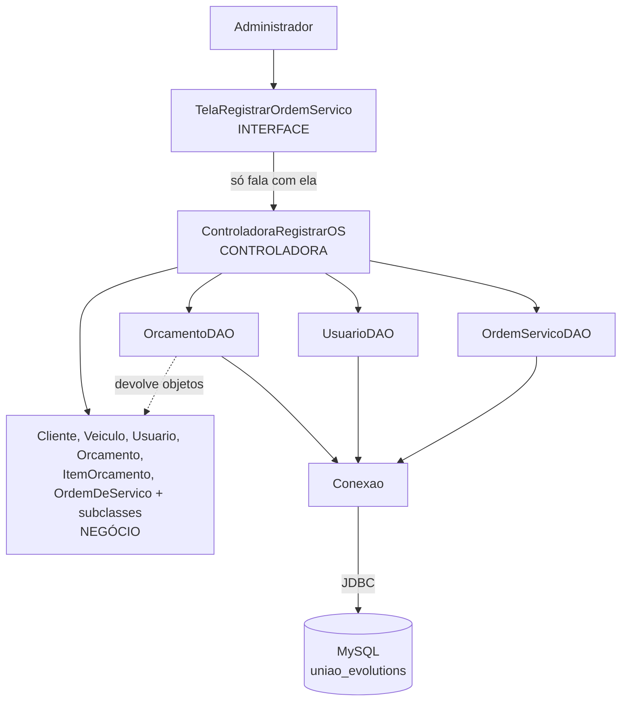

# Registrar Ordem de Serviço — União Evolutions

Trabalho Prático de APSOO — UFMS 2026.2 — Grupo G5
Implementação do caso de uso **RF-6 — Registrar Ordem de Serviço** em Java desktop, **4 camadas**
(interface, controladora, negócio e persistência), **padrão DAO**, **API JDBC** e **MySQL**.

Este documento explica o que foi implementado, **de qual artefato da modelagem veio cada decisão** e
onde os artefatos divergem entre si.

---

## 0. Artefatos usados e o que cada um determinou

A implementação não inventou nada: cada classe, cada atributo e cada mensagem tem origem num
documento do grupo. Quando dois documentos discordam, a divergência está registrada na seção 7.

| Artefato | O que ele determinou nesta implementação |
|---|---|
| `Design/Diagrama de Classes.corrigido_.docx` (01/10/2026) — **versão vigente** | As 9 classes de domínio, seus atributos e operações; as 3 DAOs; a classe `<<control>> ControladoraRegistrarOS` e a `<<boundary>> TelaRegistrarOrdemServico`. É a **fonte principal**. |
| `Design/Mapeamento_Objeto_Relacional.corrigido.docx` (01/10/2026) — **versão vigente** | O `sql/schema.sql` inteiro: nomes das tabelas, das colunas, chaves primárias, estrangeiras e `UNIQUE`. Em especial, a estratégia de mapeamento da herança. |
| `Design/CORRIGIDO-registrarOrdemServico-Diagrama_de_Comunicacao.pdf` | A **ordem exata** das 11 mensagens dentro de `ControladoraRegistrarOS.registrarOrdemServico(...)`. Os números 1.1 a 1.11 estão nos comentários do método. |
| `Analise/Contrato_Operacao_Registrar_Ordem_de_Servico.docx` | A assinatura da operação, suas pré-condições e as 14 pós-condições — que viraram o corpo do `registrarOrdemServico` e os `validar()` do domínio. |
| `Requisitos/Descricao_Expandida_Registrar_Ordem_de_Servico.docx` | Os 12 passos do fluxo principal, as 7 regras de negócio (RN-01 a RN-07), os fluxos alternativos (FA-00, FA-02, FA-09, FA-11A, FA-11B, FA-11C, FA-12), as variantes V1 e V2 e o **texto literal das mensagens** exibidas ao usuário. |
| `Requisitos/MOCKUP-registrar-ordem-de-servico.pdf` | O layout da `TelaRegistrarOrdemServico`: as 5 seções, os rótulos dos campos, a tabela de itens, o valor total e os botões. Também os dados de exemplo do `schema.sql`. |
| `Requisitos/Documento Requisitos União Evolutions 3.0.docx` | RNF-4 (opera só na rede local, sem nuvem) → MySQL local; RNF-7 (desktop multiplataforma) → Java + Swing. |

### 0.1 As classes implementadas e sua origem

Todas vêm do Diagrama de Classes vigente, com a mesma grafia:

| Classe | Camada | Atributos / operações conforme o diagrama |
|---|---|---|
| `Cliente` | negócio | `nome`, `telefone` |
| `Veiculo` | negócio | `marca`, `modelo`, `anoModelo`, `motorizacao`, `placa`, `numeroChassi`, `tipoModulo`, `modeloECU`, `identificacaoModulo`, `codigoMecanico`, `senhaImobilizador`, `senhaAlarme`, `senhaRadio` |
| `Usuario` | negócio | `idUsuario`, `nome`, `tipoUsuario : {administrador \| tecnicoDeChaves \| tecnicoDeModulos}` |
| `Orcamento` | negócio | `dataSolicitacao`, `origemAtendimento`, `segmentoPretendido`, `valorEstimado`, `status`; `getVeiculo()`, `getSegmentoPretendido()` |
| `ItemOrcamento` | negócio | `valorProposto` |
| `OrdemDeServico` (**abstrata**) | negócio | `numeroOS`, `dataAbertura`, `statusOS`, `dataEmissaoGarantia`, `textoExecutadoGarantia`, `dataEmissaoResponsabilidade`, `quilometragem`, `prazoEstimado`, `observacoes`; `sinalizarAbertura()`, `setDataAbertura()`, `setStatusOS()`, `associarOrcamento()`, `associarVeiculo()`, `associarTecnico()` |
| `OrdemDeServicoModulos` | negócio | `relatoInicial`, `condicaoRecebimento`, `diagnosticoInicial`, `testesEntradaSaida`, `confirmacaoDefeito`, `causaIdentificada`, `reparoRealizado` + construtor `<<create>>` |
| `OrdemDeServicoChaves` | negócio | `servicoExecutado` + construtor `<<create>>` |
| `OrcamentoDAO` | persistência | `buscarOrcamento(id)`, `buscarOrcamentosAprovados()` |
| `UsuarioDAO` | persistência | `buscarUsuario(id)`, `buscarTecnicosHabilitados(segmento)` |
| `OrdemServicoDAO` | persistência | `salvar(os)`, `gerarNumeroOS()` |
| `ControladoraRegistrarOS` | **controladora** | as 11 operações do diagrama |
| `TelaRegistrarOrdemServico` | interface | a `<<boundary>>` |

Três classes **não** estão no Diagrama de Classes e estão explicadas onde aparecem:
`ServicoBase` (está no Mapeamento OR), `TipoUsuario` (é o enumerado do atributo `tipoUsuario`) e
`Segmento` (só guarda os literais `"Módulos"` e `"Chaves"` num lugar só).

---

## 1. Visão geral

A **União Evolutions** repara e reprograma módulos/centrais eletrônicas (ECU) e faz programação e
confecção de chaves. O fluxo da empresa é: o cliente pede um **orçamento**; aprovado o orçamento, ele
vira uma **Ordem de Serviço**; o técnico executa e a empresa emite os comprovantes.

**Registrar Ordem de Serviço** é exatamente o ponto em que o orçamento aprovado vira OS. É a operação
mais complexa do sistema, e o próprio Contrato de Operação explica por quê:

> "É a única do fluxo normal que muda o estado dos objetos do domínio: cria a instância de Ordem de
> Serviço, forma suas associações com o Orçamento, o Veículo e o Técnico e a persiste."

O que a tela faz: lista os orçamentos aprovados, carrega cliente/veículo/itens do orçamento escolhido,
mostra o bloco de dados técnicos do segmento (Módulos **ou** Chaves), lista os técnicos habilitados,
e grava a OS com número `OS-AAAA-NNNN`.

---

## 2. Arquitetura em 4 camadas

O enunciado pede as camadas de domínio, de persistência e de interface, e lembra de **não esquecer a
camada controladora**. São as quatro:

| Camada | Pasta | Classes | Responsabilidade | O que ela **não** faz |
|---|---|---|---|---|
| **Interface** | `view` | `TelaRegistrarOrdemServico` | Desenha a janela, lê o que foi digitado, exibe mensagens. | Não tem SQL, não abre conexão e **não conhece as DAOs**. |
| **Controladora** | `controle` | `ControladoraRegistrarOS` | Coordena o caso de uso: decide a ordem das operações, aplica as regras e chama as DAOs. | Não tem SQL e não cria `JOptionPane`. |
| **Negócio** | `negocio` | `Cliente`, `Veiculo`, `Usuario`, `Orcamento`, `ItemOrcamento`, `ServicoBase`, `OrdemDeServico` + 2 subclasses | Guarda os dados e valida as regras do negócio (RN-03, RN-04). | Não sabe que existe banco nem tela. |
| **Persistência** | `persistencia` | `Conexao`, `OrcamentoDAO`, `UsuarioDAO`, `OrdemServicoDAO` | `Conexao` abre/fecha a ligação; as DAOs executam o SQL. | Não exibe mensagem: lançam a exceção para cima. |



**Por que a camada controladora existe?** Sem ela, a tela teria de chamar as três DAOs, saber a ordem
certa das operações e conhecer as regras do caso de uso — ou seja, a regra de negócio ficaria dentro
do botão Salvar. Com ela:

1. A tela conhece **uma** classe só. Se o caso de uso mudar de ordem, a tela não muda.
2. O caso de uso fica legível num arquivo só: o método `registrarOrdemServico` é o Diagrama de
   Comunicação escrito em Java, linha por linha.
3. Dá para trocar a tela (web, por exemplo) reaproveitando a controladora inteira.

A controladora é literalmente o objeto **`:Sistema`** do Diagrama de Comunicação — aquele que recebe a
mensagem 1 e dispara todas as outras.

### 2.1 Os arquivos do projeto

```
registrar-ordem-servico/
├── src/uniaoevolutions/
│   ├── MainRegistrarOrdemServico.java           abre a tela (fora da modelagem)
│   ├── view/TelaRegistrarOrdemServico.java      INTERFACE      <<boundary>>
│   ├── controle/ControladoraRegistrarOS.java    CONTROLADORA   <<control>>
│   ├── negocio/                                 NEGÓCIO
│   │   ├── OrdemDeServico.java                      (ABSTRATA) superclasse
│   │   ├── OrdemDeServicoModulos.java               subclasse — variante V1
│   │   ├── OrdemDeServicoChaves.java                subclasse — variante V2
│   │   ├── Orcamento.java   ItemOrcamento.java   ServicoBase.java
│   │   ├── Cliente.java     Veiculo.java         Usuario.java
│   │   └── TipoUsuario.java Segmento.java
│   └── persistencia/                            PERSISTÊNCIA   (padrão DAO)
│       ├── Conexao.java            abre e fecha a conexão JDBC
│       ├── OrcamentoDAO.java       buscarOrcamento, buscarOrcamentosAprovados,
│       │                           atualizarStatus, incluirItem
│       ├── UsuarioDAO.java         buscarUsuario, buscarTecnicosHabilitados
│       └── OrdemServicoDAO.java    salvar, gerarNumeroOS, buscarHistoricoTecnico
├── sql/schema.sql                   cria o banco, as 10 tabelas e os dados do mockup
├── lib/mysql-connector-j-8.4.0.jar  driver JDBC do MySQL
├── bin/                             saída da compilação
├── .vscode/settings.json            aponta src/ e lib/ para o VS Code
├── README.md                        guia de instalação e execução
├── DOCUMENTACAO.md                  este documento
└── RASTREABILIDADE.md               os 11 artefatos da 1ª iteração, um a um,
                                     com o ponto do código que implementa cada um
```

Este documento se organiza pelas **decisões de implementação**; o
[RASTREABILIDADE.md](RASTREABILIDADE.md) percorre o caminho inverso, **artefato por artefato**, na
ordem do PDF `artefatos elaborados na primeira iteração`. Quem vem da modelagem e quer achar o código
começa por lá.

São **18 arquivos-fonte**, e a pasta de cada um já diz a que camada ele pertence — a organização em
pacotes é a própria arquitetura em camadas.

---

## 3. Passo a passo do desenvolvimento

A ordem foi de baixo para cima: banco → negócio → persistência → controladora → tela.

### Passo 1 — O banco (`sql/schema.sql`)

Tradução literal do Mapeamento Objeto-Relacional. Cada `CREATE TABLE` tem, em comentário, a linha do
artefato que lhe deu origem. São 10 tabelas; a estratégia de mapeamento está detalhada na seção 4.

### Passo 2 — A camada de negócio (`negocio/`)

As classes guardam os dados e as regras. O ponto mais importante é a **herança**:

```java
public abstract class OrdemDeServico { ... }
public class OrdemDeServicoModulos extends OrdemDeServico { ... }
public class OrdemDeServicoChaves  extends OrdemDeServico { ... }
```

`OrdemDeServico` é **abstrata** (nome em itálico no diagrama) porque no negócio da empresa não existe
"uma OS genérica": toda OS é de Módulos ou de Chaves.

A herança é usada em dois lugares:

```java
// Na superclasse: o que vale para qualquer OS
public void validar() {
    if (quilometragem <= 0) throw new IllegalArgumentException("Informe a quilometragem...");
    ...
    if (!tecnico.habilitadoEm(getSegmento()))  // RN-04
        throw new IllegalArgumentException("O técnico selecionado não é habilitado...");
}

// Na subclasse: o que é próprio do segmento (RN-03)
@Override
public void validar() {
    super.validar();
    if (vazio(relatoInicial)) throw new IllegalArgumentException("Informe os sintomas relatados...");
    ...
}
```

E o polimorfismo em `getSegmento()`: cada subclasse sabe o seu próprio segmento, então a controladora
e a tela não precisam perguntar o tipo do objeto.

**Por que a validação fica no negócio e não na tela?** Porque a RN-03 e a RN-04 são regras do
**negócio**, não da tela. (A tela também confere formato e obrigatoriedade antes de chamar a
controladora, para mostrar todas as pendências de uma vez; o `validar()` continua sendo a garantia.) Se amanhã existir uma importação de OS por arquivo, ela também vai chamar
`validar()` e as regras continuam valendo. `validar()` **lança** a exceção em vez de mostrar uma
janela: a camada de negócio não sabe se existe tela.

Repare ainda no encapsulamento de `sinalizarAbertura()`:

```java
public void sinalizarAbertura() {   // 1.7
    setDataAbertura(new Date());    // 1.7.1
    setStatusOS(STATUS_ABERTA);     // 1.7.2
}
private void setDataAbertura(Date data) { ... }   // privados de propósito
private void setStatusOS(String status)  { ... }
```

Os dois `set` são **privados** exatamente como o Diagrama de Classes os marca. Quem está de fora pede
"sinalize a abertura" e a própria OS decide o que isso significa — assim não existe como gravar uma
data de abertura sem o status correspondente.

### Passo 3 — A camada de persistência (`persistencia/`)

Uma DAO por entidade, todas com `PreparedStatement` (nunca SQL concatenado — ver seção 9) e todas
fechando a conexão no `finally`.

`OrcamentoDAO.buscarOrcamento` mostra o mapeamento acontecendo: no banco o orçamento está espalhado
em cinco tabelas ligadas por chave estrangeira; o método devolve **um** objeto `Orcamento` com
`cliente`, `veiculo` e `itens` preenchidos. Quem chama não vê tabela nem `JOIN`.

`OrdemServicoDAO.salvar` é o caso mais interessante e está explicado na seção 4.

### Passo 4 — A camada controladora (`controle/ControladoraRegistrarOS.java`)

O método `registrarOrdemServico` é o Diagrama de Comunicação transcrito:

```java
Orcamento orc = orcamentoDAO.buscarOrcamento(orcamentoSelecionado);  // 1.1
Veiculo   vei = orc.getVeiculo();                                    // 1.2
Usuario   tec = usuarioDAO.buscarUsuario(tecnicoSelecionado);        // 1.3
String    seg = orc.getSegmentoPretendido();                         // 1.4

OrdemDeServico os = criarOrdemDeServico(seg, ...);                   // 1.5 / 1.6
os.sinalizarAbertura();                                              // 1.7
os.associarOrcamento(orc);                                           // 1.8
os.associarVeiculo(vei);                                             // 1.9
os.associarTecnico(tec);                                             // 1.10

os.validar();                                                        // RN-03 e RN-04
os.setNumeroOS(numeroReservado());                                   // RN-07
ordemServicoDAO.salvar(os);                                          // 1.11

orcamentoDAO.atualizarStatus(orc.getIdOrcamento(), STATUS_CONVERTIDO); // POS-02
```

Duas observações de projeto:

- As mensagens estão **na ordem exata do diagrama**, 1.1 a 1.11. (Até a auditoria da 2ª iteração,
  `sinalizarAbertura()` vinha depois de 1.8–1.10; ver RELATORIO_ITERACAO2.md, seção 10.2.)
- `validar()` (RN-03 e RN-04) não é mensagem do diagrama: fica depois de 1.10, porque a RN-04 precisa
  do técnico associado, e **antes** de `salvar()`. Se faltar campo obrigatório, o fluxo para aí e
  **o banco nem chega a ser acessado** (FA-11A); a OS marcada como aberta em 1.7 só existia em
  memória e é descartada.

O método `criarOrdemDeServico` é o ponto que o Contrato de Operação descreve como *"um objeto os de
OrdemDeServico foi criado, sendo da subclasse OrdemDeServicoModulos ou OrdemDeServicoChaves conforme
seg"*:

```java
if (Segmento.CHAVES.equals(seg)) {
    return new OrdemDeServicoChaves(quilometragem, prazoEstimado, observacoes, servicoExecutado);
}
return new OrdemDeServicoModulos(quilometragem, prazoEstimado, observacoes,
        relatoInicial, condicaoRecebimento, diagnosticoInicial);
```

### Passo 5 — A camada de interface (`view/TelaRegistrarOrdemServico.java`)

Um `JFrame` com as cinco seções do mockup, na mesma ordem e com os mesmos rótulos:

| Seção do mockup | O que a tela mostra |
|---|---|
| Identificação da OS | Orçamento associado (combo), Nº da OS (automático), Data de abertura, Prazo estimado, Situação |
| Cliente e Veículo | Cliente, Telefone/Whatsapp, Placa, Marca/Modelo, Ano, Quilometragem, botão de histórico técnico |
| Segmento do Serviço | Os dois `JRadioButton` e o aviso amarelo, com o texto literal do mockup |
| Dados Técnicos | `CardLayout` com o bloco de Módulos (V1) e o de Chaves (V2) — só um aparece |
| Execução | Técnico responsável (combo), Observações internas, tabela de itens e Valor total da OS |

Os botões do rodapé são os do mockup (**Voltar / Cancelar**, **Imprimir OS**, **Salvar Ordem de
Serviço**) mais **Salvar rascunho** (FA-11C), que existe para exercitar uma operação do Diagrama de
Classes. O **Incluir item** (FA-11B) fica no canto superior direito da seção Execução, junto da
tabela de itens.

Os botões têm o estilo do mockup (desde 11/11/2026): **Salvar Ordem de Serviço** azul cheio com
texto branco; **Imprimir OS** branco com borda e texto azuis e ícone de impressora; **Voltar /
Cancelar** branco com borda cinza; **Ver atendimentos anteriores** azul-claro com texto azul. Os que
não estão no mockup seguem o mais parecido: **Salvar rascunho** como o Voltar, **+ Incluir item** como
o Imprimir. Todos têm cantos arredondados e são desenhados pela classe interna `Botao`, porque esta
tela usa o look and feel do sistema, que ignora cor de fundo e arredondamento de um `JButton` comum.

**Validação dos campos (desde 11/11/2026, igual à do Solicitar Orçamento).** Cada campo digitável
valida **(a)** ao perder o foco e **(b)** de novo ao salvar, com o formulário inteiro. Com erro, a
moldura do campo fica vermelha e a mensagem aparece embaixo dele; ao salvar, uma caixa vermelha no
topo lista todas as pendências ("Corrija N pendências antes de salvar a Ordem de Serviço:"), que é o
FA-11A.1. Quilometragem só aceita números e ponto; o prazo só aceita números e "/" e pode ser digitado
sem barras (ddmmaaaa). O "Salvar rascunho" cobra só o que o rascunho grava (orçamento, prazo,
quilometragem e técnico). O "Incluir item" pede serviço, quantidade e valor num formulário só, com a
mesma validação, e a justificativa é obrigatória.

O ponto central desta classe: **ela não tem nenhuma linha de SQL e não importa nenhuma DAO**. O único
objeto de outra camada que ela cria é a controladora:

```java
private final ControladoraRegistrarOS controladora = new ControladoraRegistrarOS();
```

E o tratamento de erro distingue os dois tipos de problema, como manda a Descrição Expandida:

```java
catch (IllegalArgumentException erro) { mostrarAviso(erro.getMessage()); }   // FA-11A: erro do usuário
catch (SQLException erro)             { mostrarErroDeBanco(erro); }          // FA-12: falha do sistema
```

---

## 4. Mapeamento objeto-relacional

Esta é a parte destacada em negrito no enunciado. São três situações diferentes.

### 4.0 As 10 tabelas e a classe que deu origem a cada uma

| Tabela | Classe de origem | Situação do mapeamento |
|---|---|---|
| `TB_Cliente` | `Cliente` | classe simples → tabela (4.1) |
| `TB_Veiculo` | `Veiculo` | classe simples → tabela (4.1) |
| `TB_Usuario` | `Usuario` | classe simples → tabela; `tipoUsuario` virou `ENUM` |
| `TB_ServicoBase` | `ServicoBase` | classe simples → tabela; está no Mapeamento OR, não no Diagrama de Classes |
| `TB_Orcamento` | `Orcamento` | tabela + 2 chaves estrangeiras (`idCliente`, `idVeiculo`) — 4.2 |
| `TB_ItemOrcamento` | `ItemOrcamento` | **composição** → chave primária composta `(idItemOrcamento, idOrcamento)` — 4.2 |
| `TB_OrdemDeServico` | `OrdemDeServico` (abstrata) | tabela da **superclasse** — 4.3 |
| `TB_OrdemDeServicoModulos` | `OrdemDeServicoModulos` | tabela da **subclasse** V1 — 4.3 |
| `TB_OrdemDeServicoChaves` | `OrdemDeServicoChaves` | tabela da **subclasse** V2 — 4.3 |
| `TB_Pagamento` | — | consta do Mapeamento OR; **não é usada** por este caso de uso, criada só para o banco ser fiel ao artefato |

Duas colunas tiveram de ser acrescentadas ao Mapeamento OR, marcadas com `[ACRESCIMO]` no
`schema.sql` e justificadas na seção 7: `TB_ItemOrcamento.quantidade` (lacuna 7) e
`TB_OrdemDeServico.numeroOS` (lacuna 6). A terceira lacuna de banco — a justificativa exigida pela
RN-05 (lacuna 10) — **não** criou coluna nova: ela é gravada em
`TB_ServicoBase.observacoesTecnicas`, que já existia.

### 4.1 Classe simples → tabela

Caso direto: `Cliente` → `TB_Cliente`, `Veiculo` → `TB_Veiculo`, `Usuario` → `TB_Usuario`. Cada
atributo vira uma coluna, com o mesmo nome.

O objeto ganha no banco um **identificador** (`idCliente`, `idVeiculo`, ...) que não aparece como
atributo no Diagrama de Classes, mas é a chave primária no Mapeamento OR. Ele existe porque, em
memória, dois objetos são distinguidos pela referência; no banco, é preciso uma coluna que cumpra
esse papel. Por isso as classes da camada de negócio têm esse campo.

### 4.2 Associação → chave estrangeira

A associação *"Orcamento 0..1 solicita 1 Cliente"* vira a coluna `TB_Orcamento.idCliente<<FK>>`.
A regra é: na associação 1 para muitos, a chave estrangeira fica no lado **muitos**.

A **composição** *"Orcamento 1 compoe 1..\* ItemOrcamento"* (losango cheio) é mais forte: o item não
existe fora do seu orçamento. Por isso `TB_ItemOrcamento` tem a chave primária **composta**
`(idItemOrcamento, idOrcamento)` — o item é identificado junto com o pai.

A RN-02 (*"cada Ordem de Serviço está associada a exatamente um orçamento"*) virou
`idOrcamento<<FK>><<UNIQUE>>` em `TB_OrdemDeServico`: o `UNIQUE` é o que impede dois registros de OS
para o mesmo orçamento.

### 4.3 Herança → três tabelas (o caso mais importante)

O problema: banco relacional não tem herança. Existem três estratégias conhecidas — uma tabela só para
toda a hierarquia, uma tabela por subclasse, ou uma tabela por classe. **O Mapeamento OR do grupo
escolheu a terceira**:

```
TB_OrdemDeServico(idOrdemDeServico<<PK>>, numeroOS, dataAbertura, statusOS, ...)
   |
   |-- TB_OrdemDeServicoModulos(idOrdemDeServico<<PK>><<FK>>, relatoInicial, ...)
   |
   |-- TB_OrdemDeServicoChaves (idOrdemDeServico<<PK>><<FK>>, servicoExecutado)
```

A tabela da subclasse tem uma chave primária que é **ao mesmo tempo chave estrangeira** para a tabela
da superclasse. Uma linha filha só existe se existir a linha pai, e as duas têm o mesmo id — é assim
que a herança OO vira relacional.

**Consequência no código:** gravar uma OS é sempre **dois INSERTs**, numa transação
(`OrdemServicoDAO.salvar`):

```java
conexao.setAutoCommit(false);
int id = inserirSuperclasse(conexao, os);   // INSERT em TB_OrdemDeServico, devolve o id
os.setIdOrdemDeServico(id);
inserirSubclasse(conexao, os, id);          // INSERT na tabela da subclasse, com o MESMO id
conexao.commit();
```

A transação existe porque uma OS pela metade não faz sentido: ou as duas linhas nascem, ou nenhuma.
Se o segundo `INSERT` falhar, o `rollback()` desfaz o primeiro.

E a escolha da tabela é feita pelo tipo do objeto:

```java
if (os instanceof OrdemDeServicoModulos) {
    // INSERT INTO TB_OrdemDeServicoModulos ...
} else if (os instanceof OrdemDeServicoChaves) {
    // INSERT INTO TB_OrdemDeServicoChaves ...
}
```

Este `if` é o encontro entre os dois mundos: **em Java a diferença entre as subclasses é o tipo do
objeto; no banco ela é a tabela em que a linha filha é gravada.**

Na leitura, o caminho é o inverso: `buscarHistoricoTecnico` faz `LEFT JOIN` com as duas tabelas
filhas e monta a subclasse conforme qual delas trouxe linha.

**Por que essa estratégia e não uma tabela só?** Com uma tabela única, as sete colunas de Módulos
ficariam nulas em toda OS de Chaves, e vice-versa — o banco não conseguiria exigir
`relatoInicial NOT NULL`, e a tabela cresceria a cada novo segmento. A desvantagem é precisar de dois
INSERTs e de um JOIN na leitura, que é o preço pago aqui.

---

## 5. Rastreabilidade: do artefato ao código

### 5.1 Os 12 passos do fluxo principal

| Passo da Descrição Expandida | Onde está no código |
|---|---|
| 1. Exibe o formulário com nº da OS e data de abertura (RN-07) | `ControladoraRegistrarOS.iniciarRegistroOS()` → `OrdemServicoDAO.gerarNumeroOS()` |
| 2. Exibe a lista de orçamentos aprovados (RN-01) | `consultarOrcamentosAprovados()` → `OrcamentoDAO.buscarOrcamentosAprovados()` |
| 3. Administrador seleciona o orçamento | `TelaRegistrarOrdemServico.aoSelecionarOrcamento()` |
| 4. Exibe cliente, veículo, segmento e itens herdados (RN-02) | `consultarOrcamento(id)` + `preencherClienteVeiculo()` + `preencherItens()` |
| 5. Administrador informa o segmento | Os dois `JRadioButton`, pré-selecionados com o `segmentoPretendido` do orçamento |
| 6. Exibe o bloco de dados técnicos do segmento | `consultarBlocosDadosTecnicos(segmento)` + o `CardLayout` |
| 7. Informa quilometragem e prazo estimado | `campoQuilometragem`, `campoPrazoEstimado` |
| 8. Informa os dados técnicos obrigatórios (RN-03) | Bloco V1 ou V2; validados em `OrdemDeServicoModulos.validar()` / `OrdemDeServicoChaves.validar()` |
| 9. Exibe a lista de técnicos habilitados (RN-04) | `consultarTecnicosHabilitados(segmento)` → `UsuarioDAO.buscarTecnicosHabilitados()` |
| 10. Seleciona o técnico responsável | `comboTecnico` |
| 11. Informa observações e confirma | `campoObservacoes` + botão **Salvar Ordem de Serviço** |
| 12. Exibe "Ordem de Serviço OS-AAAA-NNNN registrada com sucesso" e exibe a OS | `TelaRegistrarOrdemServico.salvar()` + `mostrarOrdemRegistrada()` |

### 5.2 As 7 regras de negócio

| Regra | Onde está implementada |
|---|---|
| **RN-01** Origem obrigatória | `Orcamento.podeGerarOrdemDeServico()` + o `NOT EXISTS` de `buscarOrcamentosAprovados()` |
| **RN-02** Vínculo único | `associarOrcamento/Veiculo/Tecnico` + `idOrcamento UNIQUE` em `TB_OrdemDeServico` |
| **RN-03** Campos obrigatórios por segmento | `validar()` da superclasse e das duas subclasses |
| **RN-04** Habilitação do técnico | `Usuario.habilitadoEm()` + `TipoUsuario.habilitadoEm()` + o filtro de `buscarTecnicosHabilitados()` |
| **RN-05** Herança e alteração de valores | `incluirItemOrdemServico()` e `registrarOSComAlteracao()` (exige justificativa e devolve o orçamento a "Aguardando aprovação do cliente") |
| **RN-06** Irretratabilidade | Não há nenhum `DELETE` de OS registrada. O único `DELETE` existente só atinge linhas com `statusOS = 'Rascunho'` |
| **RN-07** Numeração `OS-AAAA-NNNN` | `OrdemServicoDAO.gerarNumeroOS()`; o reinício anual vem do `LIKE 'OS-<ano>-%'` |

### 5.3 As 6 pós-condições do caso de uso

| Pós-condição | Onde |
|---|---|
| **POS-01** OS gravada com número único | `setNumeroOS()` + `salvar()` + `numeroOS UNIQUE` |
| **POS-02** Orçamento vai para "Convertido em OS" | `orcamentoDAO.atualizarStatus(..., STATUS_CONVERTIDO)` ao fim de `registrarOrdemServico` |
| **POS-03** Itens copiados com total consolidado | `OrdemDeServico.getItens()` e `getValorTotal()` (ver nota na seção 7) |
| **POS-04** Técnico formalmente alocado | `associarTecnico()` + coluna `idUsuario<<FK>>` |
| **POS-05** Registro no histórico técnico do veículo | `OrdemServicoDAO.buscarHistoricoTecnico()` (botão "Ver atendimentos anteriores") |
| **POS-06** Registro de auditoria | **Não implementado** — ver seção 7, lacuna 5 |

### 5.4 Os fluxos alternativos

| Fluxo | Implementação | Mensagem exibida |
|---|---|---|
| **FA-02** Sem orçamento aprovado | `carregarOrcamentosAprovados()` | "Nenhum orçamento aprovado disponível para abertura de Ordem de Serviço" |
| **FA-09** Sem técnico habilitado | `aoTrocarSegmento()` | "Não há técnico habilitado disponível para este segmento" |
| **FA-11A** Campo obrigatório pendente | `validarCampos()` na tela; depois, `catch (IllegalArgumentException)` | Caixa "Corrija N pendências…" e a mensagem embaixo de cada campo; se passar pela tela, a mensagem do `validar()` |
| **FA-11B** Inclusão de item não previsto | `incluirItemOrdemServico()` + `registrarOSComAlteracao()` | Exigência de justificativa, novo total e aviso de suspensão |
| **FA-11C** Salvar rascunho | `salvarRascunhoOS()` | "Ordem de Serviço salva como rascunho" |
| **FA-12** Base de dados indisponível | `catch (SQLException)` | "Não foi possível registrar a Ordem de Serviço. Tente novamente." |
| **FA-00** Desistência | `solicitarConfirmacaoDesistencia()` + `descartarRegistro()` | "Confirma a desistência do registro da Ordem de Serviço?" |

---

## 6. Variantes V1 e V2

A escolha do segmento muda três coisas: o bloco de campos, os campos obrigatórios e a lista de
técnicos.

| | V1 — Módulos (ECU) | V2 — Chaves |
|---|---|---|
| Classe criada | `OrdemDeServicoModulos` | `OrdemDeServicoChaves` |
| Tabela filha | `TB_OrdemDeServicoModulos` | `TB_OrdemDeServicoChaves` |
| Campos editáveis | Sintomas relatados, Condição de recebimento, Diagnóstico em bancada | Serviço de chaves a executar |
| Campos exibidos do veículo | `tipoModulo`, `modeloECU`, `identificacaoModulo` | `codigoMecanico`, `senhaImobilizador` |
| Técnicos listados | `tecnicoDeModulos` + `administrador` | `tecnicoDeChaves` + `administrador` |

Repare que os campos "Tipo de módulo", "Fabricante" e "Nº da peça" do mockup **não** são atributos da
Ordem de Serviço: no Diagrama de Classes eles são atributos do **`Veiculo`** (`tipoModulo`,
`modeloECU`, `identificacaoModulo`). Por isso a tela os exibe somente para leitura, preenchidos a
partir do veículo do orçamento. O mesmo vale para os dados do imobilizador na variante V2.

---

## 7. Divergências e lacunas entre os artefatos

Esta é a seção mais provável de ser cobrada. Todas as decisões abaixo estão também em comentário no
código, no ponto em que afetam a implementação.

### Divergências (artefatos que discordam entre si)

1. **Situação da OS após a gravação: "Aberta" ou "Em execução"?**
   O **Diagrama de Comunicação** manda `setStatusOs("Aberta")` (mensagem 1.7.2) e o **Contrato de
   Operação** repete: *"os.statusOS foi atualizado para 'Aberta'"*. Mas a **POS-01** da Descrição
   Expandida diz *"situação 'Em execução'"*, e o **mockup** mostra o selo `EM EXECUÇÃO`.
   **Decisão:** seguimos `"Aberta"`, porque o enunciado pede a implementação *de acordo com o projeto
   realizado*, e o Contrato de Operação e o Diagrama de Comunicação são os artefatos de projeto que
   especificam esse comportamento. Sugerimos uniformizar a Descrição Expandida e o mockup.

2. **De onde vem o segmento: do orçamento ou do Administrador?**
   O **passo 5** do fluxo principal diz que *"o Administrador informa o segmento"*, e o mockup tem os
   dois `JRadioButton`. Mas o **Contrato de Operação** e o **Diagrama de Comunicação** derivam o
   segmento do orçamento (`seg = orc.getSegmentoPretendido()`), e `registrarOrdemServico` não tem
   parâmetro de segmento.
   **Decisão:** os dois artefatos se conciliam porque as operações
   `consultarBlocosDadosTecnicos(segmento)` e `consultarTecnicosHabilitados(segmento)` **recebem** o
   segmento como parâmetro — ou seja, a seleção da tela serve para exibir o bloco certo e filtrar os
   técnicos, exatamente como o mockup descreve, enquanto a gravação usa o segmento do orçamento. Na
   tela, o rádio já vem marcado com o `segmentoPretendido` do orçamento escolhido, então os dois
   coincidem.

3. **`Tecnico` ou `Usuario`?**
   A versão anterior do Diagrama de Classes (e o Mapeamento OR de 28/09) tinha `Tecnico`,
   `TecnicoDeChaves`, `TecnicoDeModulos`, `Usuario` e `Administrador` em hierarquia, com cinco
   tabelas. A **versão corrigida de 01/10** — a vigente — trocou tudo por uma classe `Usuario` com o
   atributo enumerado `tipoUsuario`, e o Mapeamento OR acompanhou, deixando só `TB_Usuario`.
   **Decisão:** implementamos a versão de 01/10, que é a vigente.

4. **Nome do método de associação.**
   O Diagrama de Comunicação envia `associaOS(os)` aos objetos `orc`, `vei` e `tec` (mensagens 1.8,
   1.9 e 1.10); o Diagrama de Classes põe `associarOrcamento(ocr)`, `associarVeiculo(vei)` e
   `associarTecnico(tec)` na própria `OrdemDeServico`.
   **Decisão:** seguimos o Diagrama de Classes (mais recente). As três mensagens continuam existindo,
   com o mesmo efeito, só que partindo da OS.

### Lacunas (coisas que nenhum artefato define)

5. **POS-06 — registro de auditoria.** A pós-condição exige *"usuário, data e hora da operação"*, mas
   não existe classe nem tabela de auditoria em nenhum artefato. **Não implementamos**: inventar uma
   tabela contrariaria a regra de basear o código na modelagem. Fica registrado como lacuna a ser
   corrigida numa próxima versão do Diagrama de Classes e do Mapeamento OR.

6. **`numeroOS` não está no Mapeamento OR.** O atributo existe na classe `OrdemDeServico` e a RN-07
   exige o formato `OS-AAAA-NNNN`, mas `TB_OrdemDeServico` não tem a coluna. **Acréscimo 2** do
   `schema.sql`: criamos a coluna, porque sem ela a RN-07 não teria onde ser gravada.

7. **`quantidade` não existe em `ItemOrcamento`.** O mockup tem a coluna "Qtd." e a operação
   `incluirItemOrdemServico(servicoOuPeca, quantidade, valor)` recebe a quantidade, mas nem a classe
   nem `TB_ItemOrcamento` têm o atributo. **Acréscimo 1** do `schema.sql`.

8. **Campo "CPF / CNPJ" do mockup.** A classe `Cliente` tem só `nome` e `telefone`, e `TB_Cliente`
   também. **Não implementamos o campo**, para não divergir do Diagrama de Classes vigente. Fica
   registrado: ou o mockup tira o campo, ou o Diagrama de Classes ganha o atributo.

9. **Campos da variante V2 que não existem na classe.** A V2 fala em *tipo de chave, quantidade de
   cópias, código do transponder e situação do imobilizador*, mas `OrdemDeServicoChaves` só tem
   `servicoExecutado`. A tela exibe o que a modelagem oferece: `servicoExecutado` (editável) e os
   dados de imobilizador do `Veiculo` (somente leitura).

10. **Justificativa da RN-05 não tem coluna.** A RN-05 exige *"justificativa registrada"*, mas nenhuma
    tabela tem onde guardá-la. **Decisão:** gravamos em
    `TB_ServicoBase.observacoesTecnicas`, prefixada por `"Justificativa (RN-05): "`, por ser a única
    coluna de texto livre ligada ao item incluído.

11. **POS-03 — "os itens são copiados para a OS".** O Mapeamento OR **não tem** uma tabela de itens da
    Ordem de Serviço. **Decisão:** a POS-03 é cumprida pela associação: a OS aponta para o orçamento,
    e `OrdemDeServico.getItens()` e `getValorTotal()` leem os itens dele. Não há duplicação de dados,
    que é o que o Mapeamento OR determina.

### Acréscimos à modelagem (métodos que o Diagrama de Classes não tem)

| Método | Por que foi preciso |
|---|---|
| `OrcamentoDAO.atualizarStatus()` | POS-02 e RN-05 — sem ele o orçamento nunca mudaria de situação |
| `OrcamentoDAO.incluirItem()` | FA-11B — sem ele a inclusão de item não teria efeito |
| `OrdemServicoDAO.buscarHistoricoTecnico()` | Passo 8.2 da V1, POS-05 e o botão do mockup |
| `ControladoraRegistrarOS.consultarHistoricoTecnico()` | A operação acima, exposta à tela |

---

## 8. Como rodar

O guia detalhado, com o passo a passo do XAMPP e a tabela de problemas comuns, está no
[README.md](README.md). Esta seção é a referência rápida.

### 8.1 Pré-requisitos

| O quê | Para quê |
|---|---|
| **JDK 17 ou superior** | compilar e executar |
| **XAMPP** (módulos *MySQL* e *Apache*) | o banco de dados e o phpMyAdmin |
| **VS Code** com a extensão *Extension Pack for Java* | abrir e executar o projeto |

O driver JDBC já vem junto, em `lib/mysql-connector-j-8.4.0.jar`. Nada é baixado em tempo de
execução, e **nenhum acesso à internet é necessário** — é a **RNF-4** (operação restrita à rede
local) valendo também para o ambiente de desenvolvimento.

O XAMPP instala o **MariaDB**, um fork do MySQL que fala o mesmo protocolo: o módulo continua
chamado "MySQL" no painel, a URL continua `jdbc:mysql://` e o `schema.sql` usa apenas SQL padrão
(`AUTO_INCREMENT`, `ENUM`, `FOREIGN KEY`), aceito pelos dois. Um MySQL Server instalado por fora
serve igualmente.

### 8.2 Criar o banco

**Pelo XAMPP (phpMyAdmin):** inicie os módulos **Apache** e **MySQL** no XAMPP Control Panel, abra
**http://localhost/phpmyadmin**, vá na aba **Importar**, escolha o arquivo `sql/schema.sql` e clique
em **Importar**. Não é preciso criar nem selecionar o banco antes: o script começa com
`CREATE DATABASE IF NOT EXISTS uniao_evolutions` e `USE uniao_evolutions`.

**Pelo terminal:**

```bash
mysql -u root -p < sql/schema.sql
```

O script cria as 10 tabelas e já insere os dados do mockup (cliente Marcos Antônio Ribeiro, veículo
QAF-7C21, orçamento ORC-2026-0231 aprovado com os três serviços que somam R$ 750,00, e quatro
usuários).

O script pode ser executado quantas vezes for preciso: ele apaga e recria **apenas** as tabelas
deste caso de uso, sem afetar nenhum outro banco. É assim que se zera a demonstração.

Para conferir:

```sql
USE uniao_evolutions;
SHOW TABLES;
SELECT * FROM TB_Orcamento;
```

### 8.3 Ajustar usuário e senha, se necessário

O projeto está configurado para o padrão do XAMPP: usuário `root` com senha em branco. Se o seu
banco for diferente, edite as três constantes em `src/uniaoevolutions/persistencia/Conexao.java` —
é a única classe do projeto que conhece a localização e as credenciais do banco.

### 8.4 Executar

1. No VS Code: **File → Open Folder** e escolha a pasta `registrar-ordem-servico`.
   Precisa ser **essa** pasta — a que tem `src/` e `lib/` dentro.
2. Abra `src/uniaoevolutions/MainRegistrarOrdemServico.java`.
3. Clique em **▶ Run** acima do método `main`.

Pelo terminal, também funciona. O `-sourcepath` faz o `javac` compilar sozinho tudo o que a `MainRegistrarOrdemServico`
referencia, então não é preciso listar os arquivos:

```cmd
javac -encoding UTF-8 -d bin -cp "lib\mysql-connector-j-8.4.0.jar" -sourcepath src src\uniaoevolutions\MainRegistrarOrdemServico.java
java -cp "bin;lib\mysql-connector-j-8.4.0.jar" uniaoevolutions.MainRegistrarOrdemServico
```

No Linux e no macOS, troque a `\` por `/` e o `;` do classpath por `:`.

### 8.5 Roteiro de demonstração

1. A janela abre já com o nº da OS (`OS-2026-0001`), a data de hoje e o orçamento `ORC-2026-0231`
   selecionado. Cliente, veículo e os três itens aparecem preenchidos, com o total R$ 750,00.
2. Clique em **Salvar Ordem de Serviço** sem preencher nada: a caixa vermelha do topo lista as cinco
   pendências (prazo, quilometragem e os três campos de Módulos), e cada campo fica marcado. É o
   **FA-11A**, e o banco nem foi acessado.
3. Preencha Quilometragem `120450`, Prazo `02/09/2026`, os três campos de Módulos e clique em
   **Salvar**: aparece *"Ordem de Serviço OS-2026-0001 registrada com sucesso"* e a OS impressa.
4. Repare que o orçamento `ORC-2026-0231` **sumiu da lista** — é a **POS-02** e a **RN-01**.
5. Selecione agora o orçamento de Chaves: o bloco técnico muda sozinho e a lista de técnicos passa a
   mostrar só a técnica de chaves e o administrador — é a **RN-04**.
6. Clique em **Ver atendimentos anteriores** com o veículo QAF-7C21 para ver a OS gravada no passo 3.
7. Pare o módulo MySQL no painel do XAMPP e tente salvar: aparece *"Não foi possível registrar a
   Ordem de Serviço. Tente novamente."* — é o **FA-12**.

### 8.6 Problemas comuns

| Sintoma | Causa provável |
|---|---|
| `No suitable driver found for jdbc:mysql:` | Pasta errada aberta no VS Code (tem que ser a que contém `src/` e `lib/`) |
| `Access denied for user 'root'@'localhost'` | Usuário ou senha errados em `Conexao.java` — ver 8.3 |
| `Unknown database 'uniao_evolutions'` | O `schema.sql` não foi executado — ver 8.2 |
| `Table 'uniao_evolutions.TB_Orcamento' doesn't exist` | O `schema.sql` foi executado só em parte |
| `Communications link failure` | O módulo MySQL do XAMPP não está rodando, ou não está na porta 3306 |
| O MySQL do XAMPP não inicia (*"Port 3306 in use"*) | Outro MySQL já ocupa a porta — pare o serviço dele em `services.msc` |
| "Nenhum orçamento aprovado disponível" ao abrir a tela | Os orçamentos de exemplo já foram convertidos numa demonstração anterior; reimporte o `schema.sql` |

---

## 9. Perguntas prováveis do professor

**Cadê a camada controladora?**
É a `ControladoraRegistrarOS`, no pacote `uniaoevolutions.controle`. Ela é a classe `<<control>>` do
Diagrama de Classes e o objeto `:Sistema` do Diagrama de Comunicação. A tela conversa só com ela; ela
é que chama as três DAOs e os objetos de domínio.

**Como a herança foi mapeada para o modelo relacional?**
Uma tabela por classe: `TB_OrdemDeServico` para a superclasse e `TB_OrdemDeServicoModulos` /
`TB_OrdemDeServicoChaves` para as subclasses, cada uma com a chave primária que é ao mesmo tempo
chave estrangeira para a tabela da superclasse. Gravar uma OS são dois `INSERT` dentro de uma
transação. Detalhado na seção 4.3.

**Por que `OrdemDeServico` é abstrata?**
Porque está em itálico no Diagrama de Classes e porque no negócio não existe OS genérica: toda Ordem
de Serviço é de Módulos ou de Chaves. O Contrato de Operação confirma: o objeto criado é "da subclasse
OrdemDeServicoModulos ou OrdemDeServicoChaves conforme seg".

**Onde está o Diagrama de Comunicação no código?**
No método `ControladoraRegistrarOS.registrarOrdemServico`. Cada linha tem em comentário o número da
mensagem (1.1 a 1.11).

**Por que a tela não chama a DAO direto?**
Porque aí a regra do caso de uso (que ordem seguir, o que validar, o que fazer com o orçamento depois)
ficaria dentro do botão Salvar. Com a controladora, a tela só sabe "pedir para registrar"; se amanhã a
interface virar web, a controladora é reaproveitada inteira.

**Por que o DAO não mostra mensagem?**
Porque ele é da camada de persistência: a função dele é executar SQL. Se mostrasse `JOptionPane`, não
poderia ser reaproveitado por uma versão web nem por um teste automatizado. Ele **lança** a exceção, e
quem decide como avisar o usuário é a tela.

**Por que `PreparedStatement` e não concatenar o SQL?**
Por causa de **SQL Injection**. Se o código fosse
`"... WHERE nome = '" + nomeDigitado + "'"` e o usuário digitasse `' OR '1'='1`, o comando devolveria
todos os registros; com `'; DROP TABLE ...; --` ele poderia apagar a tabela. Com `PreparedStatement`,
o banco recebe a **estrutura** do comando antes dos valores, e o que vem do `setString` é sempre
tratado como **dado**. De quebra, um nome com apóstrofo (`D'Angelo`) deixa de quebrar o SQL.

**Por que a gravação está numa transação?**
Porque a herança virou duas tabelas. Se o `INSERT` em `TB_OrdemDeServicoModulos` falhasse depois do
`INSERT` em `TB_OrdemDeServico`, ficaria uma OS sem dados técnicos — um objeto pela metade. O
`commit`/`rollback` garante tudo ou nada.

**Como a RN-07 reinicia a numeração a cada ano?**
`gerarNumeroOS()` procura o maior número que começa com `OS-<ano corrente>-`. Em 1º de janeiro não
existe nenhum, então a sequência recomeça em `0001` sozinha, sem precisar de rotina de virada de ano.

**O que acontece se dois usuários abrirem a tela ao mesmo tempo?**
Os dois receberiam o mesmo número reservado, mas a coluna `numeroOS` é `UNIQUE`: o segundo a salvar
receberia erro do banco. Num sistema real, a numeração seria gerada dentro da transação de gravação.
Fica registrado como limitação conhecida deste protótipo acadêmico.

**Por que a validação está no objeto de domínio e não na controladora?**
Porque a RN-03 e a RN-04 são regras do negócio, não do caso de uso. Ficando em `validar()`, elas valem
para qualquer coisa que crie uma OS — este caso de uso, uma importação futura, um teste. A
controladora só decide **quando** validar.

**Por que a senha do banco está no código?**
Porque é um trabalho acadêmico. Num sistema real isso seria uma falha de segurança: os dados de
conexão ficariam num arquivo de configuração externo ou em variáveis de ambiente, fora do controle de
versão.

**Por que Java desktop com Swing e MySQL local?**
Pelos requisitos não funcionais: **RNF-7** exige aplicação desktop não restrita ao Windows (Swing roda
em qualquer SO com JVM) e **RNF-4** exige operação apenas na rede local, sem nuvem (MySQL instalado na
rede da oficina).
