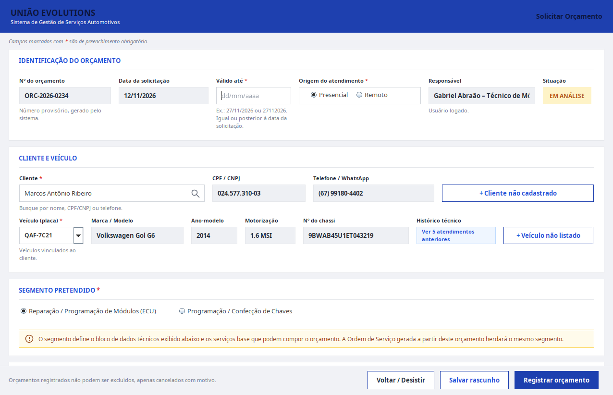
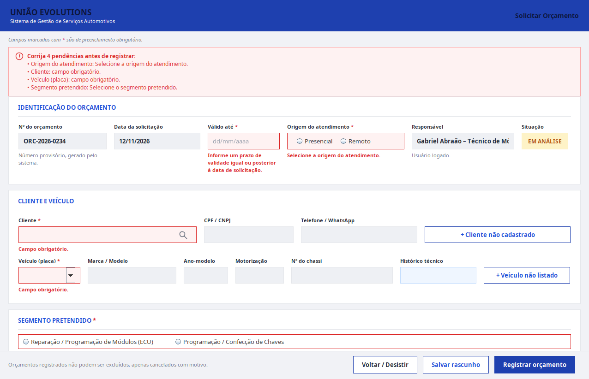
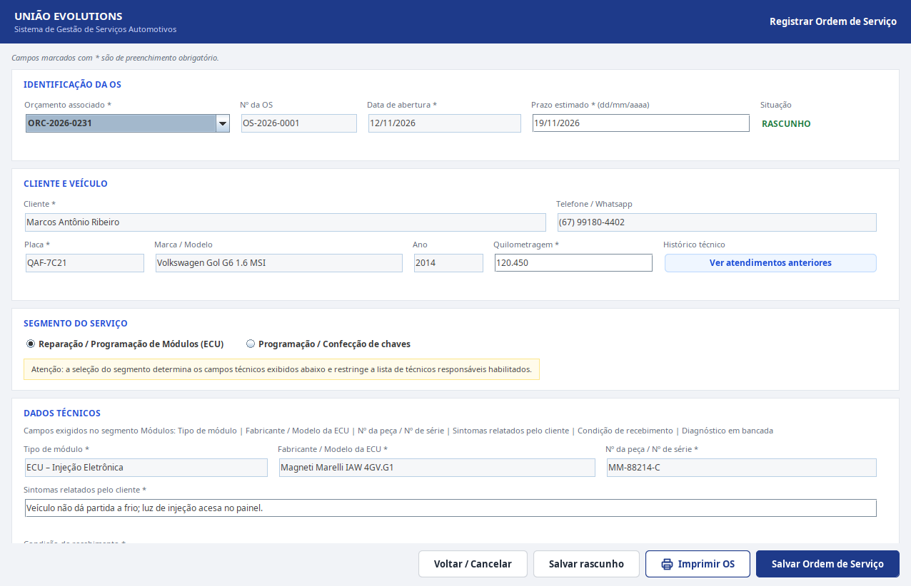

# União Evolutions: orçamentos e ordens de serviço

Sistema desktop para uma oficina de eletrônica automotiva registrar orçamentos e transformá-los em
ordens de serviço. Trabalho prático de APSOO (UFMS 2026.2, Grupo G5).

   

<p align="center">
  
  
  
</p>

## O que é

Na oficina, o técnico registra o pedido do cliente como **orçamento**: cliente, veículo, segmento
(reparo de módulos eletrônicos ou confecção de chaves), dados técnicos e serviços com valor. Aprovado
pelo cliente, o orçamento vira uma **ordem de serviço**. O projeto parte da modelagem UML da disciplina
e implementa dois casos de uso: Registrar Ordem de Serviço (1ª iteração) e Solicitar Orçamento (2ª).
Não há login porque autenticação não é caso de uso do escopo: o usuário é escolhido num menu. O banco
roda na rede local da oficina, sem nuvem (requisito RNF-4).

## Decisões técnicas

- **Herança no banco como "uma tabela por subclasse".** `Orcamento` e `OrdemDeServico` têm uma subclasse
  por segmento, e cada uma virou uma tabela própria com a chave da superclasse (`TB_Orcamento` +
  `TB_OrcamentoModulos` / `TB_OrcamentoChaves`). Evita colunas nulas do outro segmento, ao custo de
  gravar com vários `INSERT`.
- **Gravação tudo ou nada, com o objeto restaurado.** `OrcamentoDAO.gravar` insere módulo novo,
  superclasse, subclasse e itens numa transação. Se falhar, desfaz e zera os ids gerados no objeto,
  para que a nova tentativa do usuário grave tudo de novo sem duplicar nada.
- **O código segue a ordem do diagrama de comunicação.** `ControladoraSolicitarOrcamento.registrarOrcamento`
  executa as mensagens 1.1 a 1.15.3 na ordem do diagrama, numeradas nos comentários, e os nomes de
  classes e métodos são os do diagrama de classes. Dá para conferir modelo e código lado a lado.
- **Formato na tela, regra no domínio.** A tela valida o formato de cada campo ao perder o foco e de novo
  ao registrar (`Validacoes`, com `DocumentFilter` bloqueando letras em campos numéricos). As regras de
  negócio ficam na controladora e nas entidades, que lançam `IllegalArgumentException` com o texto da
  mensagem: a controladora nunca abre janela.
- **`status` do orçamento como `VARCHAR`, não `ENUM`.** As duas iterações usam vocabulários diferentes
  ("Aprovado pelo cliente" na 1ª, "Em análise" e "Rascunho" na 2ª). Um `ENUM` quebraria a 1ª iteração.

## Stack

| Função | Tecnologia |
|---|---|
| Linguagem | Java (JDK 11 ou superior), compilado com `javac`, sem ferramenta de build |
| Interface | Swing |
| Acesso a dados | JDBC com `PreparedStatement`, driver MySQL Connector/J 8.4.0 (em `lib/`) |
| Banco | MySQL ou MariaDB (no XAMPP, por exemplo) |

## Como rodar

**Pré-requisitos:** JDK 11 ou superior; MySQL ou MariaDB em `localhost:3306`, usuário `root` sem senha.

```bash
git clone https://github.com/Gabrielpossasb/UniaoChavesEvolution_APSOO.git
cd UniaoChavesEvolution_APSOO
mysql -u root < sql/schema.sql
javac -encoding UTF-8 -d bin -cp lib/mysql-connector-j-8.4.0.jar $(find src -name '*.java')
java -cp "bin:lib/mysql-connector-j-8.4.0.jar" uniaoevolutions.MenuPrincipal
```

Esses comandos são para Linux e macOS; os de Windows (`cmd`) estão em
[docs/EXECUCAO.md](docs/EXECUCAO.md#terminal-no-windows-cmd). O `schema.sql` cria o banco
`uniao_evolutions` com dados de exemplo; reimporte para voltar ao estado inicial.

**Pontos de entrada:**

| Classe | Abre |
|---|---|
| `uniaoevolutions.MenuPrincipal` | menu com a escolha do usuário e as duas telas |
| `uniaoevolutions.MainSolicitarOrcamento [idUsuario]` | só o Solicitar Orçamento; `idUsuario` de 1 a 3 (padrão 1) |
| `uniaoevolutions.MainRegistrarOrdemServico` | só o Registrar Ordem de Serviço |

**Configuração:** não há variáveis de ambiente. URL, usuário e senha do banco são as constantes `URL`,
`USUARIO` e `SENHA` de `src/uniaoevolutions/persistencia/Conexao.java`.

Passo a passo no XAMPP (Windows e Linux), uso do menu e erros comuns: [docs/EXECUCAO.md](docs/EXECUCAO.md).

## Estrutura de pastas

```
.
├── src/uniaoevolutions/
│   ├── view/            telas Swing e validação de formato
│   ├── controle/        uma controladora por caso de uso
│   ├── negocio/         entidades e regras de negócio
│   ├── persistencia/    conexão JDBC e DAOs
│   └── MenuPrincipal.java, Main*.java
├── sql/schema.sql       banco, 14 tabelas e dados de exemplo
├── lib/                 driver JDBC
└── docs/                capturas e guia de execução
```

A ligação entre cada artefato da modelagem e o código está em [DOCUMENTACAO.md](DOCUMENTACAO.md) e
[RASTREABILIDADE.md](RASTREABILIDADE.md) (1ª iteração) e em [RELATORIO_ITERACAO2.md](RELATORIO_ITERACAO2.md)
(2ª iteração).
